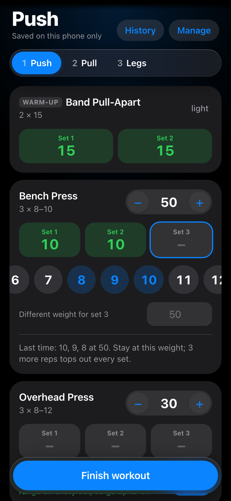
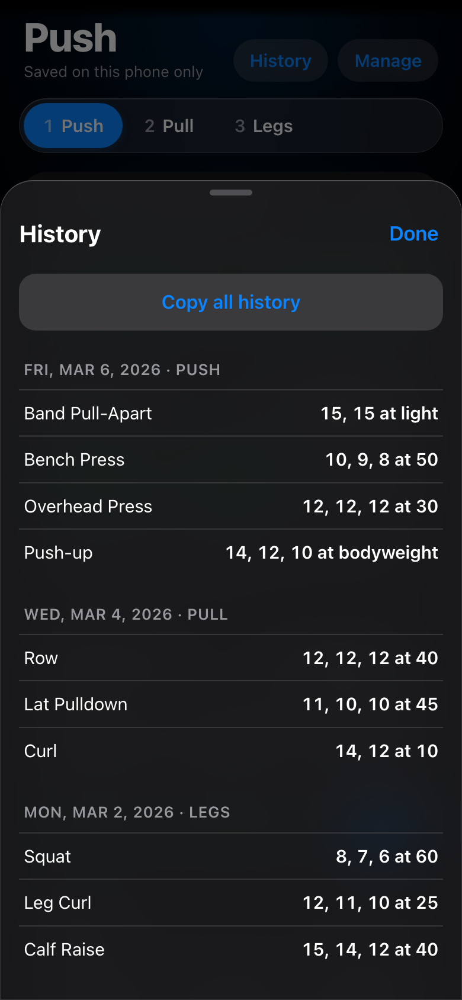
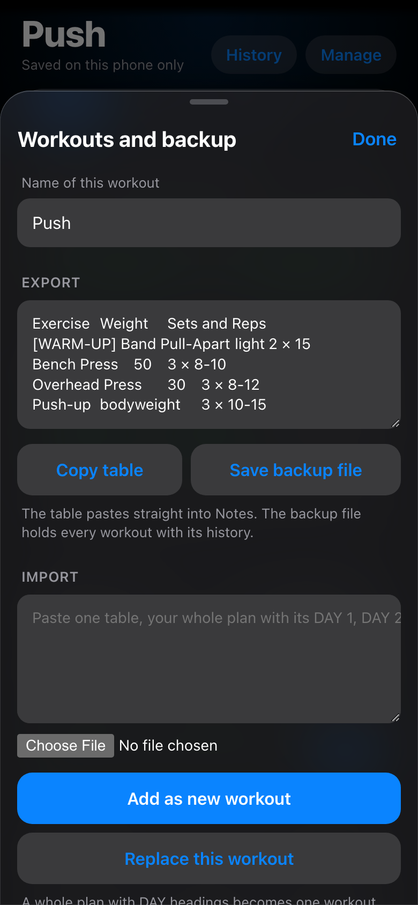

# Workout log

A personal workout tracker that runs as a home-screen web app on iPhone. Pick a training day, log reps per set, and it says whether to raise, hold or drop the weight based on each exercise's target rep range.

No server, no account, no build step. All data stays in the phone's local storage; this repo holds only the empty app.

<p>
  
  
  
</p>

The screenshots use the made-up example plan below.

## Install on iPhone

1. Open the GitHub Pages address of this repo in Safari.
2. Share → Add to Home Screen, then open it from the new icon.
3. Manage → Import: paste a table or choose a backup file.

Safari and the home-screen app keep separate storage, so import inside the home-screen app.

## Backup

Data lives only on the phone. Manage → Save backup file writes a JSON file with every workout and its history; importing that file with "Replace this workout" restores everything.

## Import formats

- **One table**, one exercise per line, tab-separated: `Name<TAB>Weight<TAB>3 × 10-12`. Prefix a name with `[WARM-UP]` or `[OPTIONAL]` to tag it.
- **A whole plan** with `DAY 1 — NAME` style headings: one workout per day. A day whose name already exists is updated and keeps its history.
- **A JSON backup** saved by the app.
- **Copied history**, the tab-separated text from History → Copy all history. Its sessions are added; ones already present are skipped.

### Example

Paste this into Manage → Import and tap "Add as new workout" to get three workouts. Columns are separated by a tab; two or more spaces or a `|` also work.

```
DAY 1 — PUSH
[WARM-UP] Band Pull-Apart	light	2 × 15
Bench Press	50	3 × 8-10
Overhead Press	30	3 × 8-12
Push-up	bodyweight	3 × 10-15

DAY 2 — PULL
Row	40	3 × 8-12
Lat Pulldown	45	3 × 10-12
[OPTIONAL] Curl	10	2 × 12-15

DAY 3 — LEGS
Squat	60	3 × 6-8
Leg Curl	25	3 × 10-12
Calf Raise	40	3 × 12-15
```

## Progression rule

Shown under each exercise once every set is logged, or from the last session. Warm-ups are skipped.

- every set at or above the top of the range: go up by the exercise's step
- every set below the bottom: drop by the step
- some sets below the bottom: hold until every set reaches it
- otherwise: hold, and show how many reps remain to top out every set

A set can be given its own weight under the rep picker (a drop set). It is saved with the session and left out of the rule above.

## Code

| File | What it holds |
|---|---|
| `index.html` | Page shell |
| `styles.css` | All styling; colours are variables at the top, `.glass` is the floating material |
| `js/model.js` | Data model, repair on load, progression rule, finishing a workout |
| `js/io.js` | Import and export |
| `js/views.js` | HTML for each screen |
| `js/app.js` | Storage and one handler per button |
| `sw.js` | Offline cache; add new files to its `FILES` list |
| `test.mjs` | Logic check |

Run locally:

```bash
python3 -m http.server 8765
```

Test:

```bash
node test.mjs
```

Deploy by pushing to `main`. The phone picks up a new version on the second launch after the push, or straight away with Manage → Update app.
